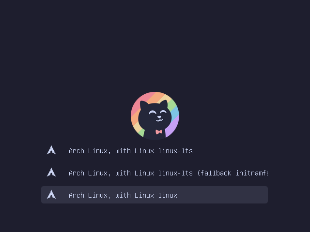
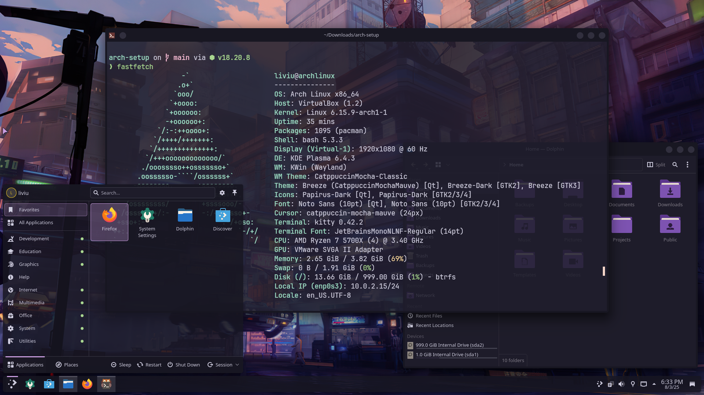

# Arch setup

| [](./assets/preview1.png) | [](./assets/preview2.png) | [](./assets/preview3.png) |
|:------------------------------------------------------------:|:------------------------------------------------------------:|:------------------------------------------------------------:|

Wallpapers from [wallpapercave.com](https://wallpapercave.com/)

## Table of Contents

- [About this project](#about-this-project)
- [Installation](#installation)
- [Profiles](#profiles)
  - [Base](#base)
    - [Official Arch packages](#official-arch-packages)
    - [AUR packages](#aur-packages)
    - [Fonts](#fonts)
    - [Requirements](#requirements)
    - [Browser plugins](#browser-plugins)
- [Available aliases](#available-aliases)
- [Mounts](#mounts)
- [Setup SSH](#setup-ssh)
- [Additional notes](#additional-notes)
- [Development](#development)

## About this project

This is a personal Arch Linux setup designed to streamline the installation and configuration of both general-purpose and workstation-specific environments. It provides a modular, reproducible, and well-documented system tailored for daily productivity, development, and media work.

The repository includes:

- Automated setup scripts for clean installs
- Curated lists of essential Arch, AUR, and external packages
- Workstation-specific configurations (e.g., B450 I AORUS PRO WIFI)
- Theming, aliases, and plugin selections for browsers and terminals

This project serves as both a starting point and a living reference for managing and maintaining a reliable Arch-based workstation.

## Installation

### archinstall requirements

The scripts expect a system installed with `archinstall` using these choices:

- **Bootloader:** GRUB
- **Disk layout:** btrfs
- **Swap:** zram
- **Kernels:** `linux` and `linux-lts`
- **Profile:** Desktop, KDE Plasma, with the SDDM greeter
- **Graphics driver:** the one for the machine's GPU (AMD / NVIDIA open kernel)
- **Audio:** PipeWire
- **Network configuration:** NetworkManager
- **Additional packages:** `linux-headers linux-lts-headers`, required by the DKMS drivers; archinstall adds them by itself only with the NVIDIA open kernel driver

### Get the repositories

This repository is public, so a clean install clones it without authenticating to anything:

```bash
sudo pacman -S --needed git
git clone https://github.com/ionesculiviucristian/arch-setup.git ~/Projects/arch-setup
~/Projects/arch-setup/install.sh
~/Projects/arch-setup/install.sh b450-i-aorus-pro-wifi
```

The machine profiles install Bitwarden, whose SSH agent holds the key that the private layer is cloned with. Unlock the vault, turn the SSH agent on in the application settings, then:

```bash
git clone git@github.com:ionesculiviucristian/arch-setup-private.git ~/Projects/arch-setup-private
~/Projects/arch-setup-private/install.sh
```

- the GitHub password and its two-factor code are never needed: the key in the vault is the authentication, and the `git@github.com` remotes reach it through the `SSH_AUTH_SOCK` that the `bitwarden` setup writes to `~/.bashrc.d`
- the machine profile has to run before the private layer, because `bitwarden` is listed in the machine profiles and not in base
- `arch-setup-private` carries its own instructions for importing the secrets

### Install

```bash
# Base workstation, installed on every machine
./install.sh

# Only some phases: pre, packages, external, aur, setups, resources, themes (pre and resources are base only)
./install.sh base packages setups

# Machine profile, on top of base
./install.sh b450-i-aorus-pro-wifi
./install.sh hp-victus-15-fb0029nq

# Only some phases of a machine profile
./install.sh b450-i-aorus-pro-wifi setups

# Update official, AUR (including -git) and external packages, fonts, tmux plugins, Go tools and mise tools
./update.sh

# Themes are optional: add --themes to any of the above, or run only the themes phase
./install.sh --themes
./update.sh --themes
./install.sh base themes
```

- `.env` is created from `.env.example` on the first run (theme, reflector country, night color)
- logs are written to `install_<profile>.log` and `install_errors_<profile>.log` in the repository root
- debug messages (package lists, scripts run, downloads, fstab entries) are enabled with `--debug` on `install.sh` and `update.sh`, or with `ARCH_SETUP_DEBUG=1`; they are printed and also written to `install_<profile>.log` / `update_base.log`, next to the command output

## Profiles

- [Base](./profiles/base/README.md): `./install.sh`, installed on every machine
- [B450 I AORUS PRO WIFI](./profiles/b450-i-aorus-pro-wifi/README.md): `./install.sh b450-i-aorus-pro-wifi`, on top of the base profile
- [HP Victus 15-fb0029nq](./profiles/hp-victus-15-fb0029nq/README.md): `./install.sh hp-victus-15-fb0029nq`, on top of the base profile

### Base

#### Official Arch packages

- [7-Zip](https://www.7-zip.org/) \[[source](https://github.com/ip7z/7zip/)\]: File archiver for extremely high compression
- [Ark](https://apps.kde.org/ark/) \[[source](https://invent.kde.org/utilities/ark/)\]: Archiving Tool
  - Optional dependencies:
    - [7-Zip](https://www.7-zip.org/): 7Z format support
    - [unrar](https://www.rarlab.com/rar_add.htm): RAR decompression support
- [Atuin](https://atuin.sh/) \[[source](https://github.com/atuinsh/atuin/)\]: Magical shell history
- [bandwhich](https://github.com/imsnif/bandwhich/): Terminal bandwidth utilization tool
- [base-devel](https://archlinux.org/) \[[source](https://gitlab.archlinux.org/archlinux/packaging/packages/base-devel/)\]: Basic tools to build Arch Linux packages
- [Bash](https://www.gnu.org/software/bash/) \[[source](https://cgit.git.savannah.gnu.org/cgit/bash.git/)\]: The GNU Bourne Again shell
  - Optional dependencies:
    - [bash-completion](https://github.com/scop/bash-completion/): for tab completion
- [Bash Language Server](https://github.com/bash-lsp/bash-language-server/): Bash language server implementation based on Tree Sitter and its grammar for Bash
  - Optional dependencies:
    - [bash-completion](https://github.com/scop/bash-completion/): for CLI args completion
    - [man-db](https://man-db.nongnu.org/): for documentation via manual pages
    - [sh](https://pkg.go.dev/mvdan.cc/sh/v3): for formatting support
    - [ShellCheck](https://www.shellcheck.net/): for linting support
- [bash-completion](https://github.com/scop/bash-completion/): Programmable completion for the bash shell
- [bat](https://github.com/sharkdp/bat/): Cat clone with syntax highlighting and git integration
- [BIND 9](https://www.isc.org/bind/) \[[source](https://gitlab.isc.org/isc-projects/bind9/)\]: A complete, highly portable implementation of the DNS protocol
- [broot](https://dystroy.org/broot/) \[[source](https://github.com/Canop/broot/)\]: Fuzzy Search + tree + cd
- [Btop++](https://github.com/aristocratos/btop/): A monitor of system resources, bpytop ported to C++
  - Optional dependencies:
    - [ROCm SMI library](https://rocm.docs.amd.com/projects/rocm_smi_lib/en/latest/): AMD GPU support
- [BTRFS maintenance](https://github.com/kdave/btrfsmaintenance/): Btrfs maintenance scripts
- [BTRFS tools](https://btrfs.readthedocs.io/en/latest/) \[[source](https://github.com/kdave/btrfs-progs/)\]: Btrfs filesystem utilities
- [buildx](https://www.docker.com/) \[[source](https://github.com/docker/buildx/)\]: Docker CLI plugin for extended build capabilities with BuildKit
- [direnv](https://direnv.net/) \[[source](https://github.com/direnv/direnv/)\]: A shell extension that manages your environment
- [Docker](https://www.docker.com/) \[[source](https://github.com/docker/cli/)\]: Pack, ship and run any application as a lightweight container
  - Optional dependencies:
    - [BTRFS tools](https://btrfs.readthedocs.io/en/latest/): btrfs backend support
    - [buildx](https://www.docker.com/): extended build capabilities
    - [pigz](https://www.zlib.net/pigz/): parallel gzip compressor support
- [Docker Compose](https://www.docker.com/) \[[source](https://github.com/docker/compose/)\]: Fast, isolated development environments using Docker
- [Dolphin](https://apps.kde.org/dolphin/) \[[source](https://invent.kde.org/system/dolphin/)\]: KDE File Manager
  - Optional dependencies:
    - [FFmpegThumbs](https://apps.kde.org/ffmpegthumbs/): video thumbnails
    - [KDE Graphics Thumbnailers](https://apps.kde.org/kdegraphics_thumbnailers/): PDF and PS thumbnails
    - [Konsole](https://apps.kde.org/konsole/): terminal panel
- [ExifTool](https://exiftool.org/) \[[source](https://github.com/exiftool/exiftool/)\]: Read and write EXIF information
- [expac](https://github.com/falconindy/expac/): alpm data (pacman database) extraction utility
- [eza](https://eza.rocks/) \[[source](https://github.com/eza-community/eza/)\]: A modern replacement for ls (community fork of exa)
- [fastfetch](https://github.com/fastfetch-cli/fastfetch/): A feature-rich and performance oriented neofetch like system information tool
  - Optional dependencies:
    - [ImageMagick](https://imagemagick.org/): Image output using sixel or kitty graphics protocol
- [fd](https://github.com/sharkdp/fd/): Simple, fast and user-friendly alternative to find
- [FFmpegThumbs](https://apps.kde.org/ffmpegthumbs/) \[[source](https://invent.kde.org/multimedia/ffmpegthumbs/)\]: FFmpeg-based thumbnail creator for video files
- [FileZilla](https://filezilla-project.org/) \[[source](https://svn.filezilla-project.org/svn/FileZilla3/trunk/)\]: Fast and reliable FTP, FTPS and SFTP client
- [Firefox](https://www.firefox.com/) \[[source](https://github.com/mozilla-firefox/firefox/)\]: Fast, Private & Safe Web Browser
- [fwupd](https://fwupd.org/) \[[source](https://github.com/fwupd/fwupd/)\]: Simple daemon to allow session software to update firmware
- [fzf](https://junegunn.github.io/fzf/) \[[source](https://github.com/junegunn/fzf/)\]: Command-line fuzzy finder
  - Optional dependencies:
    - [tmux](https://github.com/tmux/tmux/wiki): fzf-tmux script for launching fzf in a tmux pane
    - [Vim](https://www.vim.org/): plugin
- [git](https://git-scm.com/) \[[source](https://github.com/git/git/)\]: the fast distributed version control system
  - Optional dependencies:
    - [less](https://www.greenwoodsoftware.com/less/): the default pager for git
    - [man-db](https://man-db.nongnu.org/): show help with `git command --help`
    - [OpenSSH](https://www.openssh.org/): ssh transport and crypto
- [GitHub CLI](https://cli.github.com/) \[[source](https://github.com/cli/cli/)\]: The GitHub CLI
  - Optional dependencies:
    - [git](https://git-scm.com/): To interact with repositories
- [Go](https://go.dev/) \[[source](https://github.com/golang/go/)\]: Core compiler tools for the Go programming language
- [GRUB](https://www.gnu.org/software/grub/) \[[source](https://cgit.git.savannah.gnu.org/cgit/grub.git/)\]: GNU GRand Unified Bootloader (2)
- [Gwenview](https://apps.kde.org/gwenview/) \[[source](https://invent.kde.org/graphics/gwenview/)\]: A fast and easy to use image viewer
- [iotop-c](https://github.com/Tomas-M/iotop/): A top utility for IO
- [Kate](https://apps.kde.org/kate/) \[[source](https://invent.kde.org/utilities/kate/)\]: Advanced text editor
  - Optional dependencies:
    - [Bash Language Server](https://github.com/bash-lsp/bash-language-server/): Bash LSP support
    - [git](https://git-scm.com/): git-blame plugin
    - [Konsole](https://apps.kde.org/konsole/): open a terminal in Kate
    - [ShellCheck](https://www.shellcheck.net/): Bash linting
- [KCalc](https://apps.kde.org/kcalc/) \[[source](https://invent.kde.org/utilities/kcalc/)\]: Scientific Calculator
- [KDE Connect](https://kdeconnect.kde.org/) \[[source](https://invent.kde.org/network/kdeconnect-kde/)\]: Adds communication between KDE and your smartphone
  - Optional dependencies:
    - [SSHFS](https://github.com/libfuse/sshfs/): remote filesystem browser
- [KDE Graphics Thumbnailers](https://apps.kde.org/kdegraphics_thumbnailers/) \[[source](https://invent.kde.org/graphics/kdegraphics-thumbnailers/)\]: Thumbnailers for various graphics file formats
- [KDE Partition Manager](https://apps.kde.org/partitionmanager/) \[[source](https://invent.kde.org/system/partitionmanager/)\]: A KDE utility that allows you to manage disks, partitions, and file systems
- [kitty](https://sw.kovidgoyal.net/kitty/) \[[source](https://github.com/kovidgoyal/kitty/)\]: A modern, hackable, featureful, OpenGL-based terminal emulator
  - Optional dependencies:
    - [ImageMagick](https://imagemagick.org/): viewing images with icat
- [Konsole](https://apps.kde.org/konsole/) \[[source](https://invent.kde.org/utilities/konsole/)\]: KDE terminal emulator
- [kpackage](https://invent.kde.org/frameworks/kpackage/): Framework that lets applications manage user installable packages of non-binary assets
- [KScreenLocker](https://invent.kde.org/plasma/kscreenlocker/): Library and components for secure lock screen architecture
- [KWin](https://kde.org/plasma-desktop/) \[[source](https://invent.kde.org/plasma/kwin/)\]: An easy to use, but flexible, Wayland compositor
- [lazygit](https://github.com/jesseduffield/lazygit/): Simple terminal UI for git commands
- [less](https://www.greenwoodsoftware.com/less/) \[[source](https://github.com/gwsw/less/)\]: A terminal based program for viewing text files
- [LibreOffice](https://www.libreoffice.org/) \[[source](https://git.libreoffice.org/core/)\]: LibreOffice branch which contains new features and program enhancements
- [lsof](https://lsof.readthedocs.io/en/latest/) \[[source](https://github.com/lsof-org/lsof/)\]: Lists open files for running Unix processes
- [man-db](https://man-db.nongnu.org/) \[[source](https://gitlab.com/man-db/man-db/)\]: A utility for reading man pages
- [man-pages](https://www.kernel.org/doc/man-pages/) \[[source](https://git.kernel.org/pub/scm/docs/man-pages/man-pages.git/)\]: Linux man pages
- [mise](https://mise.jdx.dev/) \[[source](https://github.com/jdx/mise/)\]: The front-end to your dev env
  - Optional dependencies:
    - [bash-completion](https://github.com/scop/bash-completion/): bash completion support
- [NCurses Disk Usage](https://dev.yorhel.nl/ncdu) \[[source](https://code.blicky.net/yorhel/ncdu/)\]: Disk usage analyzer with an ncurses interface
- [neovim](https://neovim.io/) \[[source](https://github.com/neovim/neovim/)\]: Fork of Vim aiming to improve user experience, plugins, and GUIs
  - Optional dependencies:
    - [wl-clipboard](https://github.com/bugaevc/wl-clipboard/): for clipboard support on wayland (see :help clipboard)
- [Nmap](https://nmap.org/) \[[source](https://svn.nmap.org/nmap/)\]: Utility for network discovery and security auditing
- [NTFS-3G](https://www.tuxera.com/) \[[source](https://github.com/tuxera/ntfs-3g/)\]: NTFS FUSE driver
  - Optional dependencies:
    - [ntfsprogs](https://www.tuxera.com/): userspace utilities
- [ntfsprogs](https://www.tuxera.com/) \[[source](https://github.com/tuxera/ntfs-3g/)\]: NTFS userspace utilities
- [nvtop](https://github.com/Syllo/nvtop/): GPUs process monitoring for AMD, Intel and NVIDIA
- [Okular](https://apps.kde.org/okular/) \[[source](https://invent.kde.org/graphics/okular/)\]: Document Viewer
  - Optional dependencies:
    - [unrar](https://www.rarlab.com/rar_add.htm): Comic Book Archive support
- [OpenPrinting CUPS](https://openprinting.github.io/cups/) \[[source](https://github.com/OpenPrinting/cups/)\]: OpenPrinting CUPS - daemon package
- [OpenSSH](https://www.openssh.org/) \[[source](https://github.com/openssh/openssh-portable/)\]: SSH protocol implementation for remote login, command execution and file transfer
  - Optional dependencies:
    - [Bash](https://www.gnu.org/software/bash/): for ssh-copy-id and findssl.sh
- [pacman](https://pacman.archlinux.page/) \[[source](https://gitlab.archlinux.org/pacman/pacman/)\]: A library-based package manager with dependency support
  - Optional dependencies:
    - [base-devel](https://archlinux.org/): required to use makepkg
- [pacman-contrib](https://gitlab.archlinux.org/pacman/pacman-contrib/): Contributed scripts and tools for pacman systems
  - Optional dependencies:
    - [neovim](https://neovim.io/): default diff program for pacdiff if EDITOR=nvim
    - [plocate](https://plocate.sesse.net/): faster mlocate alternative
    - [Vim](https://www.vim.org/): default diff program for pacdiff
- [pigz](https://www.zlib.net/pigz/) \[[source](https://github.com/madler/pigz/)\]: Parallel implementation of the gzip file compressor
- [plocate](https://plocate.sesse.net/) \[[source](https://git.sesse.net/?p=plocate)\]: Alternative to locate, faster and compatible with mlocate's database.
- [pnpm](https://pnpm.io/) \[[source](https://github.com/pnpm/pnpm/)\]: Fast, disk space efficient package manager
- [procs](https://github.com/dalance/procs/): A modern replacement for ps written in Rust
- [reflector](https://xyne.dev/projects/reflector/) \[[source](https://xyne.dev/projects/reflector/src/)\]: A Python 3 module and script to retrieve and filter the latest Pacman mirror list.
  - Optional dependencies:
    - [rsync](https://rsync.samba.org/): rate rsync mirrors
- [ripgrep](https://github.com/BurntSushi/ripgrep/): A search tool that combines the usability of ag with the raw speed of grep
- [rsync](https://rsync.samba.org/) \[[source](https://github.com/RsyncProject/rsync/)\]: A fast and versatile file copying tool for remote and local files
- [SDDM](https://github.com/sddm/sddm/): QML based X11 and Wayland display manager
- [sh](https://pkg.go.dev/mvdan.cc/sh/v3) \[[source](https://github.com/mvdan/sh/)\]: Format shell programs
- [ShellCheck](https://www.shellcheck.net/) \[[source](https://github.com/koalaman/shellcheck/)\]: Shell script analysis tool
- [shtab](https://tqdm.github.io/shtab/) \[[source](https://github.com/tqdm/shtab/)\]: Automagic shell tab completion for Python CLI applications
- [SSHFS](https://github.com/libfuse/sshfs/): FUSE client based on the SSH File Transfer Protocol
- [Starship](https://starship.rs/) \[[source](https://github.com/starship/starship/)\]: The cross-shell prompt for astronauts
- [superfile](https://superfile.dev/) \[[source](https://github.com/yorukot/superfile/)\]: Pretty fancy and modern terminal file manager
  - Optional dependencies:
    - [ExifTool](https://exiftool.org/): metadata plugin
- [systemd](https://systemd.io/) \[[source](https://github.com/systemd/systemd/)\]: system and service manager
- [Thunderbird](https://www.thunderbird.net/) \[[source](https://github.com/thunderbird/thunderbird-desktop/)\]: Standalone mail and news reader from mozilla.org
- [tldr](https://pypi.org/project/tldr/) \[[source](https://github.com/tldr-pages/tldr-python-client/)\]: Command line client for tldr, a collection of simplified man pages.
- [tmux](https://github.com/tmux/tmux/wiki) \[[source](https://github.com/tmux/tmux/)\]: Terminal multiplexer
- [tmuxp](https://tmuxp.git-pull.com/) \[[source](https://github.com/tmux-python/tmuxp/)\]: Tmux session manager built on libtmux
  - Optional dependencies:
    - [shtab](https://tqdm.github.io/shtab/): for workspace completion and import
- [ufw](https://launchpad.net/ufw) \[[source](https://git.launchpad.net/ufw/)\]: Uncomplicated and easy to use CLI tool for managing a netfilter firewall
- [unrar](https://www.rarlab.com/rar_add.htm): The RAR uncompression program
- [unzip](https://infozip.sourceforge.net/UnZip.html): For extracting and viewing files in .zip archives
- [usbutils](https://git.kernel.org/pub/scm/linux/kernel/git/gregkh/usbutils.git/about/): A collection of USB tools to query connected USB devices
  - Optional dependencies:
    - [Bash](https://www.gnu.org/software/bash/): for usb-devices
- [uv](https://docs.astral.sh/uv/) \[[source](https://github.com/astral-sh/uv/)\]: An extremely fast Python package installer and resolver written in Rust
- [Vim](https://www.vim.org/) \[[source](https://github.com/vim/vim/)\]: Vi Improved, a highly configurable, improved version of the vi text editor
- [wl-clipboard](https://github.com/bugaevc/wl-clipboard/): Command-line copy/paste utilities for Wayland
- [zip](https://infozip.sourceforge.net/Zip.html): Compressor/archiver for creating and modifying zipfiles
- [zoxide](https://github.com/ajeetdsouza/zoxide/): A smarter cd command for your terminal
  - Optional dependencies:
    - [fzf](https://junegunn.github.io/fzf/): for interactive selection
- [zram-generator](https://github.com/systemd/zram-generator/): Systemd unit generator for zram devices

#### AUR packages

- [AnyDesk](https://anydesk.com/): The Fast Remote Desktop Application
- [ble.sh](https://github.com/akinomyoga/ble.sh/): Bash Line Editor (ble.sh) -- a replacement for Bash's line editor with enhanced features
- [Brave](https://brave.com/) \[[source](https://github.com/brave/brave-browser/)\]: Web browser that blocks ads and trackers by default (binary release)
  - Optional dependencies:
    - [OpenPrinting CUPS](https://openprinting.github.io/cups/): Printer support
- [downgrade](https://archlinux-downgrade.github.io/downgrade/) \[[source](https://github.com/archlinux-downgrade/downgrade/)\]: Bash script for downgrading one or more packages to a version in your cache or the A.L.A.
- [gita](https://github.com/nosarthur/gita/): Command-line tool to manage multiple git repos
- [NordVPN](https://nordvpn.com/) \[[source](https://github.com/NordSecurity/nordvpn-linux/)\]: NordVPN CLI tool for Linux
- [NordVPN GUI](https://nordvpn.com/) \[[source](https://github.com/NordSecurity/nordvpn-linux/)\]: GUI for NordVPN
- [OneDrive](https://abraunegg.github.io/) \[[source](https://github.com/abraunegg/onedrive/)\]: Free OneDrive client written in D - abraunegg's fork
- [OneDriveGUI](https://github.com/bpozdena/OneDriveGUI/): A simple GUI for OneDrive Linux client, with multi-account support.
- [Papirus](https://store.kde.org/p/1166289/) \[[source](https://github.com/PapirusDevelopmentTeam/papirus-icon-theme/)\]: Pixel perfect icon theme for Linux
- [Papirus Folders](https://github.com/PapirusDevelopmentTeam/papirus-folders/): Allows changing the color of folders in Papirus icon theme and its forks
- [Postman](https://www.postman.com/product/): Build, test, and document your APIs faster
- [uosc](https://github.com/tomasklaen/uosc/): Feature-rich minimalist proximity-based UI for MPV player.
- [Visual Studio Code](https://code.visualstudio.com/) \[[source](https://github.com/microsoft/vscode/)\]: Visual Studio Code (vscode): Editor for building and debugging modern web and cloud applications (official binary version)
- [Yay](https://jguer.github.io/yay/) \[[source](https://github.com/Jguer/yay/)\]: Yet another yogurt. Pacman wrapper and AUR helper written in go.
- [Zoom](https://www.zoom.com/): Video Conferencing and Web Conferencing Service
  - Optional dependencies:
    - [Noto fonts Emoji](https://fonts.google.com/noto): emojis

#### Fonts

- [Commit Mono Font](https://commitmono.com/) \[[source](https://github.com/eigilnikolajsen/commit-mono/)\]: Commit Mono is an anonymous and neutral coding font focused on creating a better reading experience
- [JetBrainsMono Nerd Font](https://www.nerdfonts.com/) \[[source](https://github.com/ryanoasis/nerd-fonts/)\]: JetBrains Mono: a typeface made for developers
- [Noto fonts](https://fonts.google.com/noto) \[[source](https://github.com/notofonts/notofonts.github.io/)\]: Google Noto TTF fonts
  - Optional dependencies:
    - [Noto fonts CJK](https://fonts.google.com/noto): CJK characters
    - [Noto fonts Emoji](https://fonts.google.com/noto): Emoji characters
    - [Noto fonts Extra](https://fonts.google.com/noto): additional variants (condensed, semi-bold, extra-light)
- [Noto fonts CJK](https://fonts.google.com/noto) \[[source](https://github.com/notofonts/noto-cjk/)\]: Google Noto CJK fonts
- [Noto fonts Emoji](https://fonts.google.com/noto) \[[source](https://github.com/googlefonts/noto-emoji/)\]: Google Noto Color Emoji font
- [Noto fonts Extra](https://fonts.google.com/noto) \[[source](https://github.com/notofonts/notofonts.github.io/)\]: Google Noto TTF fonts - additional variants

#### Requirements

- [go-yq](https://mikefarah.gitbook.io/yq) \[[source](https://github.com/mikefarah/yq/)\]: Portable command-line YAML processor

#### Browser plugins

##### Brave

###### Interface

- [Catppuccin Chrome Theme - Mocha](https://chromewebstore.google.com/detail/catppuccin-chrome-theme-m/bkkmolkhemgaeaeggcmfbghljjjoofoh): Soothing pastel theme for Google Chrome - Catppuccin Mocha
- [Stylus](https://chromewebstore.google.com/detail/stylus/clngdbkpkpeebahjckkjfobafhncgmne): Redesign the web with Stylus, a user styles manager
  - [Catppuccin Userstyles](https://github.com/catppuccin/userstyles/releases/download/all-userstyles-export/import.json): Soothing pastel userstyles

###### GitHub

- [Material Icons for GitHub](https://chromewebstore.google.com/detail/material-icons-for-github/bggfcpfjbdkhfhfmkjpbhnkhnpjjeomc): Material icons for the file browser of popular websites like GitHub, Azure, Bitbucket etc.
- [Octotree - GitHub code tree](https://chromewebstore.google.com/detail/octotree-github-code-tree/bkhaagjahfmjljalopjnoealnfndnagc): GitHub on steroids
- [Refined GitHub](https://chromewebstore.google.com/detail/refined-github/hlepfoohegkhhmjieoechaddaejaokhf): Simplifies the GitHub interface and adds many useful features

###### YouTube

- [DeArrow](https://chromewebstore.google.com/detail/dearrow-better-titles-and/enamippconapkdmgfgjchkhakpfinmaj): Crowdsourcing titles and thumbnails to be descriptive and not sensational
- [Enhancer for YouTube™](https://chromewebstore.google.com/detail/enhancer-for-youtube/ponfpcnoihfmfllpaingbgckeeldkhle): Take control of YouTube and boost your user experience!
- [Return YouTube Dislike](https://chromewebstore.google.com/detail/return-youtube-dislike/gebbhagfogifgggkldgodflihgfeippi): Returns ability to see dislikes
- [SponsorBlock for YouTube - Skip Sponsorships](https://chromewebstore.google.com/detail/sponsorblock-for-youtube/mnjggcdmjocbbbhaepdhchncahnbgone): Skip sponsorships, subscription begging and more on YouTube videos

###### Misc

- [Augmented Steam](https://chromewebstore.google.com/detail/augmented-steam/dnhpnfgdlenaccegplpojghhmaamnnfp): Augments your Steam Experience
- [Bitwarden Password Manager](https://chromewebstore.google.com/detail/bitwarden-password-manage/nngceckbapebfimnlniiiahkandclblb): At home, at work, or on the go, Bitwarden easily secures all your passwords, passkeys, and sensitive information
- [Google Translate](https://chromewebstore.google.com/detail/google-translate/aapbdbdomjkkjkaonfhkkikfgjllcleb): View translations easily as you browse the web
- [Plasma Integration](https://chromewebstore.google.com/detail/plasma-integration/cimiefiiaegbelhefglklhhakcgmhkai): Provides better integration with the KDE Plasma desktop
- [Pricy](https://chromewebstore.google.com/detail/pricy/jnpfnacconjipomhfkphknjfmcnhagpb): Pricy is your best friend when buying online
- [QR Code Generator](https://chromewebstore.google.com/detail/qr-code-generator/afpbjjgbdimpioenaedcjgkaigggcdpp): A super handy QR Code Generator / Creator for you
- [Vimium](https://chromewebstore.google.com/detail/vimium/dbepggeogbaibhgnhhndojpepiihcmeb): The Hacker's Browser. Vimium provides keyboard shortcuts for navigation and control in the spirit of Vim.

##### Firefox

###### Interface

- [Firefox Color](https://addons.mozilla.org/en-US/firefox/addon/firefox-color): Build, save and share beautiful Firefox themes
  - [Catppuccin Mocha - Mauve](https://addons.mozilla.org/en-US/firefox/addon/catppuccin-mocha-mauve-git): Soothing pastel theme for Firefox (Official)
- [Stylus](https://addons.mozilla.org/en-US/firefox/addon/styl-us): Redesign your favorite websites with Stylus, an actively developed and community driven userstyles manager
  - [Catppuccin Userstyles](https://github.com/catppuccin/userstyles/releases/download/all-userstyles-export/import.json): Soothing pastel userstyles

###### GitHub

- [Material Icons for GitHub](https://addons.mozilla.org/en-US/firefox/addon/material-icons-for-github): Replace the file/folder icons on github file browsers with icons representing the file's type and which tool it is used by
- [Octotree - GitHub code tree](https://addons.mozilla.org/en-US/firefox/addon/octotree): GitHub on steroids
- [Refined GitHub](https://addons.mozilla.org/en-US/firefox/addon/refined-github-): Simplifies the GitHub interface and adds many useful features

###### Development

- [Google Lighthouse](https://addons.mozilla.org/en-US/firefox/addon/google-lighthouse): Lighthouse is an open-source, automated tool for improving the performance, quality, and correctness of your web apps
- [JSONView](https://addons.mozilla.org/en-US/firefox/addon/jsonview): View JSON documents in the browser
- [React Developer Tools](https://addons.mozilla.org/en-US/firefox/addon/react-devtools): React Developer Tools is a tool that allows you to inspect a React tree, including the component hierarchy, props, state, and more
- [VisBug](https://addons.mozilla.org/en-US/firefox/addon/visbug): Open source browser design tools
- [Vue.js devtools](https://addons.mozilla.org/en-US/firefox/addon/vue-js-devtools): DevTools extension for debugging Vue.js applications

###### YouTube

- [DeArrow](https://addons.mozilla.org/en-US/firefox/addon/dearrow): Crowdsourcing titles and thumbnails to be descriptive and not sensational
- [Enhancer for YouTube™](https://addons.mozilla.org/en-US/firefox/addon/enhancer-for-youtube): Take control of YouTube and boost your user experience!
- [Return YouTube Dislike](https://addons.mozilla.org/en-US/firefox/addon/return-youtube-dislikes): Returns ability to see dislike statistics on youtube
- [SponsorBlock - Skip Sponsorships on YouTube](https://addons.mozilla.org/en-US/firefox/addon/sponsorblock): Easily skip YouTube video sponsors

###### Misc

- [Bitwarden Password Manager](https://addons.mozilla.org/en-US/firefox/addon/bitwarden-password-manager): At home, at work, or on the go, Bitwarden easily secures all your passwords, passkeys, and sensitive information
- [Offline QR Code Generator](https://addons.mozilla.org/en-US/firefox/addon/offline-qr-code-generator): This add-on allows you to quickly generate a QR code offline with the URL of the open tab or any (selected) other text!
- [Plasma Integration](https://addons.mozilla.org/en-US/firefox/addon/plasma-integration): Multitask efficiently by controlling browser functions from the Plasma desktop
- [To Google Translate](https://addons.mozilla.org/en-US/firefox/addon/to-google-translate): Right-click a section of text and click the Translate icon next to it to text translate or listen to it in your language
- [uBlock Origin](https://addons.mozilla.org/en-US/firefox/addon/ublock-origin): Finally, an efficient wide-spectrum content blocker
- [Vimium](https://addons.mozilla.org/en-US/firefox/addon/vimium-ff): The Hacker's Browser. Vimium provides keyboard shortcuts for navigation and control in the spirit of Vim.

## Available aliases

Run `aliases` after installation for a list of all available aliases.

## Mounts

Mounts are optional and configured in `mounts.json` (start from `mounts.example.json`); without it they are skipped.

- `system`: `/etc/fstab` entries, added by `os/setup.sh`; a source is a directory, `UUID=<uuid>` or `SERIAL:<serial>:<partition>`
- `onedrive`: bind mounts into `~/OneDrive`, added by the `onedrive-abraunegg` setup together with its `sync_list`

```bash
./install.sh base pre
./repositories/packages/onedrive-abraunegg/setup.sh
```

## Setup SSH

The `openssh` setup runs with the base packages: it enables `sshd`, disables root login and password authentication. Add your key to `~/.ssh/authorized_keys` before relying on it.

```bash
./repositories/packages/openssh/setup.sh
```

## Additional notes

Copy the kitty terminfo to a remote server before connecting via SSH

```bash
infocmp -a xterm-kitty | ssh <host> tic -x -o \~/.terminfo /dev/stdin
```

Or connect with `kitten ssh <host>`, which copies it automatically.

## Development

```bash
npm i
```

`npm i` installs the git hooks: pre-commit runs shellcheck, shfmt and `bash -n` on the staged `.sh` files, validates every yml/json against `schemas/` and regenerates the READMEs and `.bash_aliases_help`; commit-msg runs commitlint. Repository rules for contributors and agents are in [`AGENTS.md`](./AGENTS.md).

### VirtualBox setup

#### Host

```bash
vm="arch"

vm_dir="$(VBoxManage showvminfo "${vm}" --machinereadable | grep CfgFile | cut -d'"' -f2 | xargs dirname)" 

serial="VBOXDATA01"

VBoxManage createmedium disk --filename "${vm_dir}/hdd.vdi" --size 20480

VBoxManage storageattach "${vm}" \
  --storagectl "SATA" \
  --port 1 \
  --type hdd \
  --medium "${vm_dir}/hdd.vdi"

VBoxManage setextradata "${vm}" \
  "VBoxInternal/Devices/ahci/0/Config/Port1/SerialNumber" \
  "${serial}"
```

#### Guest

```bash
sudo pacman -Syu git firefox virtualbox-guest-utils
sudo systemctl enable --now vboxservice.service
sudo usermod -aG vboxsf "${USER}"

sudo parted /dev/sdb mklabel gpt
sudo parted /dev/sdb mkpart primary ntfs 0% 100%

sudo mkfs.ntfs -f /dev/sdb1

lsblk -no NAME,SERIAL

# Create after the HDD is mounted
mkdir -p "/mnt/hdd/Tests/Books/"
mkdir -p "/mnt/hdd/Tests/Pictures/"
```

#### Automated test

`scripts/virtualbox-test.sh --create <iso>` creates the VM from `scripts/virtualbox/virtualbox.yml`, installs Arch unattended and takes the `clean` snapshot. The config is grouped like the VirtualBox settings pages, `general`, `system`, `display` and `storage`, plus `guest` (user and password of the user and root) and `snapshot`; EFI and NAT are fixed.

`storage.disks` is attached to the SATA ports in order, so the first disk is `/dev/sda` and must be the one with `type: system`, which archinstall installs on. Every other disk gets one GPT partition formatted with its `type` and the `directories` it lists, as mount sources for `mounts.json`. Each disk reports its `serial` to the guest, so a `SERIAL:<serial>:<partition>` entry of `mounts.json` resolves in the VM exactly as it does on the real machine.

The install is driven by cloud-init from the ISO: a `CIDATA` seed passes `scripts/virtualbox/archinstall/user_configuration.json` (the [archinstall requirements](#archinstall-requirements) plus the Guest Additions from `virtualbox-guest-utils` and `ntfsprogs` for the formatting), the first 5 servers of the host `/etc/pacman.d/mirrorlist`, the commands that prepare the other disks and the guest user with passwordless sudo.

```bash
scripts/virtualbox-test.sh --create ~/Downloads/archlinux-2026.11.01-x86_64.iso

# Another VM, e.g. to compare graphics controllers: a copy of virtualbox.yml with another name and graphics_controller
scripts/virtualbox-test.sh --config scripts/virtualbox/virtualbox-vboxsvga.yml --create ~/Downloads/archlinux-2026.11.01-x86_64.iso
```

Every run of `scripts/virtualbox-test.sh` restores `clean`, copies the working tree (uncommitted changes included) to `~/Projects/arch-setup` in the guest, installs `mounts.example.json` as its `mounts.json`, runs `install.sh` with the arguments after `--` and copies the logs to `vm-logs/<vm>-<date>/`. The host `mounts.json` is never copied, so the VM mounts only the disks of `storage.disks`:

```bash
scripts/virtualbox-test.sh
scripts/virtualbox-test.sh -- base setups --debug
scripts/virtualbox-test.sh -- base --themes
scripts/virtualbox-test.sh --keep -- b450-i-aorus-pro-wifi
```

`install.sh` runs over Guest Control, which has no session bus of its own, so every command first takes the environment of the Plasma session the guest logs into (`scripts/virtualbox/session.sh`); without it `plasma-apply-lookandfeel` and the other theme tools abort.

`--config` defaults to `scripts/virtualbox/virtualbox.yml`; `--keep` leaves the VM running to inspect it.
